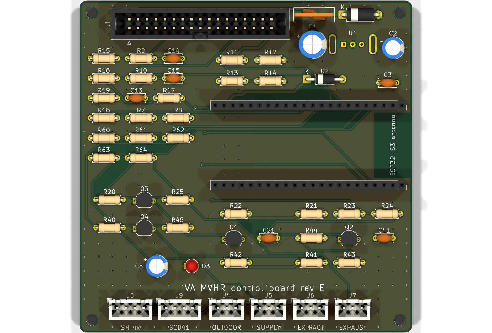
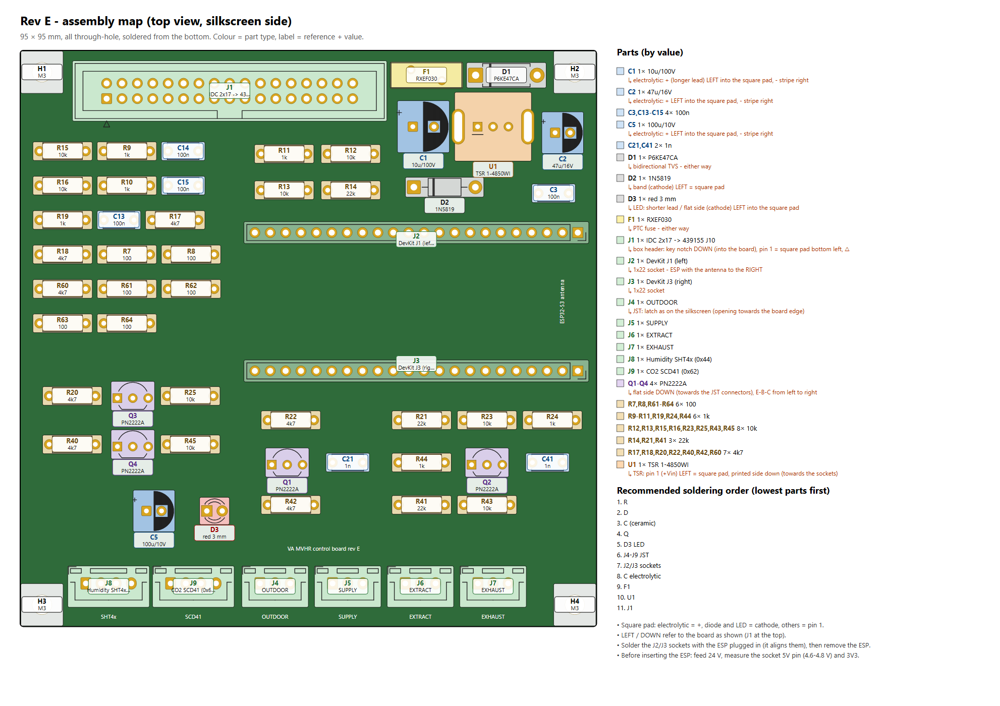
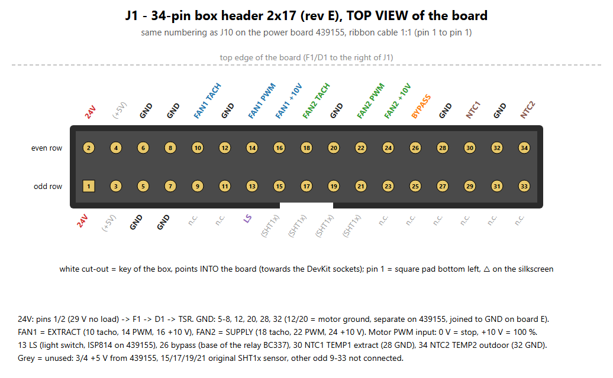

# ventaxia-esphome – ESP32-S3 control board for Vent-Axia Sentinel Kinetic MVHR

A drop-in replacement for the **Vent-Axia 439150 control board** of the older two-board Sentinel Kinetic heat
recovery units (control board 439150 + power board 439155). The new board plugs into **J10 of the power board 439155**
with the original 34-way ribbon cable and is controlled from **Home Assistant** through **ESPHome**.



> **Not for the newer single-board units (497497 / 497498).**
> The power board 439155 carries mains voltage. Connect or disconnect the ribbon cable only with the unit unplugged.
> Work inside the unit only if you are qualified to do so. You use this design at your own risk.

> Vent-Axia and Sentinel Kinetic are trademarks of their owners. This is an independent project, not affiliated with
> or endorsed by Vent-Axia. The PCB itself carries no manufacturer name ("VA MVHR control board rev E").

## Status

| | |
|---|---|
| Hardware | **Rev E**, built and running in the unit since 9 Nov 2026 |
| Firmware | `firmware/ventaxia_reve.yaml` (ESPHome 2026.10, ESP-IDF) |
| Earlier prototype | `firmware/ventaxia_alpha.yaml` – NodeMCU ESP8266 on a breadboard (same control logic) |

The control logic runs **on the ESP**. Home Assistant only changes the mode and the settings and shows the state.
Without Home Assistant or Wi-Fi the unit keeps running with the last settings stored in flash.

## Features

- Two EC fans (ebm-papst, 0–10 V PWM input) with tacho feedback, soft ramp, fan-fault detection and latching
- Modes **Auto / Low / Normal / Boost / Manual**, night mode with its own levels and weekend offset
- Three daily **airing** slots, **boost**, **fireplace** (more supply than extract to light a stove),
  **cooker hood** (extract off, supply as make-up air), **holiday**
- **Summer bypass** with hysteresis, **free cooling**, **frost protection** (bypass or airflow mode), cold-house
  protection, dry-air protection (indoor RH from HA)
- **Filter monitoring**: age, run hours and clog detection from the rpm drift at the same PWM against a learned
  clean-filter reference
- Light-switch input (LS) boost, like the original control board
- Rev E extras: 4× DS18B20 (outdoor, supply, extract, exhaust), SHT4x humidity, SCD41 CO₂, heat recovery efficiency
- Fail-safe fan driver: the fans **stop** in reset, while flashing, with the ESP removed or without 3V3/5V

All settings live in one versioned record in flash, so a firmware update does not reset them.
The full description of every function is in the header of [firmware/ventaxia_reve.yaml](firmware/ventaxia_reve.yaml).

## Repository layout

| Path | Content |
|---|---|
| [hardware/mvhr_ctrl/](hardware/mvhr_ctrl/) | KiCad 10 project of rev E, schematic and assembly PDF, BOM, renders, fab data |
| [hardware/mvhr_ctrl/fab/](hardware/mvhr_ctrl/fab/) | `mvhr_ctrl_jlcpcb.zip` (Gerber X2 + Excellon), ODB++, single Gerber files |
| [hardware/tools/](hardware/tools/) | Python generators of the schematic, board, footprint, fab data and the drawings below |
| [hardware/mvhr_ctrl/README.cs.md](hardware/mvhr_ctrl/README.cs.md) | Detailed hardware notes in Czech (fab rules, fault behaviour, review items) |
| [firmware/](firmware/) | ESPHome configurations and their generator |
| [docs/bring-up.md](docs/bring-up.md) | Step-by-step bring-up and measurements |
| [docs/control_strategy.cs.md](docs/control_strategy.cs.md) | How the unit should be controlled, background for the logic (Czech) |

## Hardware (rev E)

- 95 × 95 mm, 2 layers, 1.6 mm, **through-hole parts only** – assembled at home
- MCU: **ESP32-S3-DevKitC-1** (N8R8 or N16R8) in two 1×22 sockets. The **Waveshare ESP32-S3-DEV-KIT-N8R8** is pin
  compatible; it overhangs the right board edge by about 2 mm
- Power: 24 V from J10 → PTC fuse F1 → TVS P6KE47CA → **TRACO TSR 1-4850WI** (9–72 V in, 5 V) → 1N5819 → DevKit 5V pin
- Fan PWM: two transistor stages per fan (Q3/Q1, Q4/Q2), **non-inverted** (GPIO high = fan runs); Q1/Q2 are biased on
  from the motor's own +10 V, so the PWM line is held low (fan stopped) whenever the ESP does not actively drive it
- Connectors: J1 box header 2×17 to 439155 J10, J4–J7 JST XH-3 (1-Wire), J8/J9 JST XH-4 (I²C)

| Document | |
|---|---|
| Schematic | [mvhr_ctrl_schematic.pdf](hardware/mvhr_ctrl/mvhr_ctrl_schematic.pdf) |
| BOM | [mvhr_ctrl_bom.csv](hardware/mvhr_ctrl/mvhr_ctrl_bom.csv), purchase list incl. DevKit, sockets and cables [nakup_revE.csv](hardware/mvhr_ctrl/nakup_revE.csv) |
| Assembly | [assembly map](hardware/mvhr_ctrl/assembly_map_revE_en.png) (every part with value and polarity; Czech: [osazovaci_mapa_revE.png](hardware/mvhr_ctrl/osazovaci_mapa_revE.png)), [assembly PDF](hardware/mvhr_ctrl/mvhr_ctrl_assembly.pdf) |
| J1 / J10 pinout | [J1_pinout_top_en.png](hardware/mvhr_ctrl/J1_pinout_top_en.png) (Czech: [J1_pinout_top.png](hardware/mvhr_ctrl/J1_pinout_top.png)) |

### Assembly map

Top view with every part's reference, value and polarity, the BOM grouped by value and the recommended soldering
order. Vector version: [assembly_map_revE_en.svg](hardware/mvhr_ctrl/assembly_map_revE_en.svg); Czech version: [osazovaci_mapa_revE.png](hardware/mvhr_ctrl/osazovaci_mapa_revE.png).



### J10 / J1 pinout (34-way ribbon, 1:1)

Top view of J1 as placed on the board (same numbering as J10 on the power board 439155):



| Pin | Signal | Pin | Signal |
|---|---|---|---|
| 1, 2 | +24 V | 5–8, 12, 20, 28, 32 | GND |
| 10 / 14 / 16 | FAN1 (extract) tacho / PWM / +10 V | 18 / 22 / 24 | FAN2 (supply) tacho / PWM / +10 V |
| 13 | LS – light switch input (opto on 439155) | 26 | bypass relay (base of BC337 on 439155) |
| 30 | NTC1 TEMP1 (extract air) | 34 | NTC2 TEMP2 (outdoor) |

### ESP32-S3 pin map

| GPIO | Function | GPIO | Function |
|---|---|---|---|
| 4 | FAN1 extract PWM (ledc, 1 kHz) | 1 | NTC1 TEMP1, ADC1_CH0 |
| 5 | FAN2 supply PWM | 2 | NTC2 TEMP2, ADC1_CH1 |
| 6 | FAN1 tacho (PCNT) | 8 / 9 | I²C SDA / SCL (SHT4x 0x44, SCD41 0x62) |
| 7 | FAN2 tacho (PCNT) | 17 | 1-Wire, 4× DS18B20 |
| 15 | bypass relay | 18 | status LED D3 |
| 16 | LS input | | |

### Notes from the build

- **F1:** designed for Littelfuse RXEF030; **RXEF040 (Littelfuse RF2566)** works as well (same 72 V rating and
  5.1 mm pitch, hold 0.4 A). The board draws about 0.1–0.15 A from 24 V.
- With the Waveshare DevKit, check that 3V3 stays above 3.2 V under Wi-Fi load (its LDO may be an AMS1117).

### Ordering the PCB

Upload `hardware/mvhr_ctrl/fab/mvhr_ctrl_jlcpcb.zip` to JLCPCB: 2 layers, 95 × 95 mm, FR-4, 1.6 mm, 1 oz,
HASL lead-free, no assembly.

### Regenerating the design

The schematic and the board are generated by scripts. Run them with KiCad 10's Python
(`C:\Program Files\KiCad\10.0\bin\python.exe` on Windows) from `hardware/tools`:

```
python make_fp_tsr1wi.py         # TRACO TSR 1WI footprint with case pins
python build_sch_e.py            # schematic
python route_e_until_clean.py    # board placement + Freerouting until DRC is clean
python export_fab_e.py           # Gerber, drill, ODB++, PDFs, BOM, renders
python make_assembly_map.py [en] # assembly map SVG (Czech, or English with "en")
python make_j1_pinout.py [en]    # J1 pinout SVG (Czech, or English with "en")
```

Routing needs Freerouting 2.5.0 and a Java runtime in `hardware/tools/ext/` (`freerouting/freerouting-2.5.0.jar`);
they are not part of the repository. Freerouting is not deterministic, so a rerun gives a different track layout.

## Firmware

1. Copy `firmware/secrets.example.yaml` to `firmware/secrets.yaml` and fill in Wi-Fi, API key and passwords.
2. Flash `firmware/ventaxia_reve.yaml` with ESPHome. The first flash goes over USB, later updates over Wi-Fi.
3. Add the device in Home Assistant (ESPHome integration) with the API encryption key.

The YAML files are **generated** – edit `firmware/gen/fw_template.yaml` (logic shared by both boards) and
`firmware/gen/reve.py` (rev E hardware layer), then run:

```
python firmware/gen/gen_fw.py
```

With a `secrets.yaml` present it also writes `*_builder.yaml` copies with the secrets inlined for the ESPHome Builder
app; those copies are git-ignored and must never be committed.

Before using it in your home, adapt the substitutions at the top of the YAML: the Home Assistant entities used as
backups (`ha_outdoor`, `ha_indoor_rh`, `ha_indoor_t`), the NTC parameters and the DS18B20 addresses (printed in the
log after the first boot with the sensors connected).

## Bring-up

Follow [docs/bring-up.md](docs/bring-up.md): visual check, resistance checks without power, 24 V without the ESP,
with the ESP, and finally in the unit – first without the ESP to confirm that the fans stay stopped.

## License

| Part | License |
|---|---|
| Hardware (`hardware/mvhr_ctrl/`) and documentation (`docs/`) | [CC BY-NC-SA 4.0](LICENSES/CC-BY-NC-SA-4.0.txt) – you may build, modify and share it for non-commercial use with attribution; shared adaptations keep the same licence. Selling boards, kits or the design needs the author's permission |
| Firmware (`firmware/`) and generator scripts (`hardware/tools/`) | [MIT](LICENSES/MIT.txt) |

Details in [LICENSE](LICENSE). Vent-Axia and Sentinel Kinetic are trademarks of their owners and are used only to
describe compatibility.
